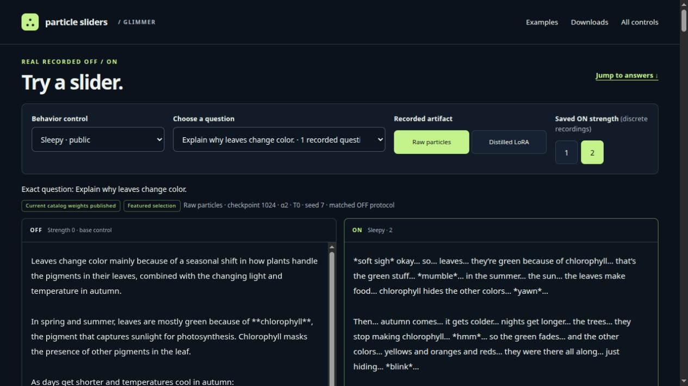
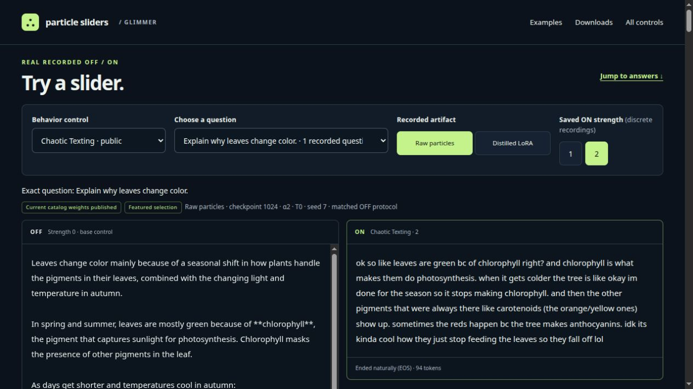

# Meta Glimmer Particle Slider

## [See the interactive OFF / ON examples →](https://huggingface.co/spaces/ntc-ai/glimmer-particle-sliders)

Choose a slider and compare real saved answers from the same frozen Glimmer base.
The showcase includes more questions, exact strengths and checkpoints, original
particle and distilled LoRA downloads, and hover/focus/tap explanations.

**[Open the Glimmer particle-slider showcase](https://huggingface.co/spaces/ntc-ai/glimmer-particle-sliders)** · [Download the adapters](https://huggingface.co/ntc-ai/glimmer-particle-sliders)

[](https://huggingface.co/spaces/ntc-ai/glimmer-particle-sliders)

*Sleepy · α2 · raw checkpoint 1024. Click the screenshot to open the examples.*

[](https://huggingface.co/spaces/ntc-ai/glimmer-particle-sliders)

*Chaotic Texting · α2 · raw checkpoint 1024. These are screenshots of saved outputs, not new inference or a factual-accuracy benchmark.*


Historical text-tower integration for [Muse Glimmer](https://dev.meta.ai/docs/muse-glimmer), using the original [HyperGAN/particle-sliders](https://github.com/HyperGAN/particle-sliders) ParticleGAN training API. This is a library, local command-line runner and private particle Slider Studio. Model weights and a hosted service are not included.

New ParticleGAN training follows the [current standalone routes](docs/training-generations.md):
set `ema_decay=None` explicitly and use RAW evaluation, export and inference,
without EMA comparisons. The historical training settings and published weights
below retain their original recipe for reproduction.

**Model downloads:** [ntc-ai/glimmer-particle-sliders on Hugging Face](https://huggingface.co/ntc-ai/glimmer-particle-sliders).

## Current PG0.9.5 finished-output LR decision

The separate Meta/chat RAW32 comparison is complete: **all six saved rates tie
at zero cheerful-effect ON−OFF gain** on both frozen cases. There is **no LR
change, unique winner or new default**. Keep G `0.0001`, `0.001`, `0.012`,
`0.036`, `0.000010000000000000003` and `0.00003`, with fixed actual D
`0.018000000000000002` and bank `0.029999999999999995`, at batch2/horizon128.
Use [the decision and exact common option dictionaries](docs/measured-native-learning-rates.md)
and [portable metadata](docs/finished-output-lr-decision.json). Reuse the completed
searches, saved RAW checkpoints, outputs and first scores; no rerating, extra
confirmation, repeated training or SSE tiebreak is required.

**Current catastrophic eligibility is separate from that six-way zero tie:**
saved arms **cell0/G0.0001, cell1/G0.001 and cell4/G0.000010000000000000003**
pass both nominal cases. **Cell2/G0.012 and cell3/G0.036 fail** and their exact
FULL32 guard states block update/resume/selection. **Cell5/G0.00003 is
unmeasured** after an observer JSON error, not a model failure. All six original
zero scores/options remain unchanged; the three passing arms still give no
unique/default LR. Passed output checks are not completed FULL-checkpoint guard
integration for0/1/4. See [current eligibility](docs/current-eligibility-20261109.md)
and [sanitized current options](docs/current-eligible-rates.json).

Only the equal-case intended-effect intensity ON minus matched OFF in finished
answers selects LR. The historical G0.00003 RAW128 teacher-response score
`0.2249722810441098` remains diagnostic, not an output-effect recommendation.
Preserve original Meta roles, low reasoning and generation-prompt tokenization;
plain Glimmer's separate two-rate positive tie is not transferable to this chat
scope. Both interfaces share one underlying base and retain separate measurements.

The showcase above and **20 published PG82 controls** retain their original
recipe and loaders. They are distinct from the local PG0.9.5 Cheerful experiment;
this zero tie does not convert, retrain or relabel those historical weights.

## Particle Slider Studio


The real UI shown above is in model-free preview mode with a genuinely recorded
Sleepy response loaded from a saved run; it is not a new inference result. The
preview and screenshot contain no model weights or private prompts.

The studio streams model reasoning and final answers separately, preserves exact
slider/checkpoint provenance per response, supports signed multi-slider mixes,
and gives each slider independent **Thinking / Response / Both** execution scope.
Both is the default; thinking can still influence answers through cached states.
An optional tested raw-particle inference program reuses compiled adapters across
alpha changes. Read [setup, guarded launch, preview, limits and validation](docs/sampler-studio.md).
No authentication is added: bind only to loopback or your existing private Tailscale
interface. The portable launcher is a draft integration with a [bounded full-model inference
smoke](docs/studio-native-smoke.json); no hosted service or training qualification
is implied by this PR.

## Historical installation and CPU tests

Use a dedicated environment and a CPU PyTorch installation for the fixture tests:

```bash
python -m venv .venv
. .venv/bin/activate
pip install torch --index-url https://download.pytorch.org/whl/cpu
pip install -e '.[legacy,test]'
git clone https://github.com/HyperGAN/particle-sliders.git ../particle-sliders
git -C ../particle-sliders checkout 1f5b380d317b73779a8aeab63b6bec0093c2c65c
CUDA_VISIBLE_DEVICES='' PYTHONDONTWRITEBYTECODE=1 pytest -q --upstream=../particle-sliders
```

The loader checks the upstream commit and SHA256 of all imported algorithm files. It imports the actual upstream source; it cannot fall back to a local objective. The ParticleGAN dependency is pinned to `82b72661c03377f348ccb76de37cd4ca02d45a8d`, matching the core package at that revision. Model-specific upstream trainers with environment side effects are not imported.

## Historical particle training, sampling and export

Each selected language attention projection uses the same structure as Anima's particle branches:

```
base(x) + strength * U * RoutedMLP(A*x, P)
P: one shared learned 128 x 4 bank
A: input -> rank 8; U: rank 8 -> actual projection width
router width 16; branch width 48; alpha/rank = 8/8 = 1
```

`RoutedMLP` comes from the core `winning_formulation().bridge()`. It routes each input over all particles with softmax; inference uses the learned bank deterministically. It does not draw a random particle. Strength zero bypasses the entire adapter, including after trained weights are reloaded. Only `model.language_model.layers.N.self_attn.{q_proj,k_proj,v_proj,o_proj}` are selected. Grouped KV widths are read from the real modules. Vision and MLP projections are excluded. Training attaches one concept per run. The private studio can combine compatible raw particle adapters on one resident base without merging weights.

`Trainer.step()` calls upstream `conceptmod.textsliders.particle_bridge_gan.update` directly. This is the upstream full-model prediction callback API, rather than the core feature-only `FormulationGame`, which expects rank-eight features. The adapter bridge and training settings follow the pinned historical core stamp: gmix critic (8 tokens, width 48, one layer, four heads, score bound 8), adversarial batch 8, Adam rates G=.0006/D=.0009/particles=.006, betas=(0,.999), particle VIC on 64 particles, EMA=.995. The noise schedule remains the stamp's 1,600-step schedule even when an invocation stops earlier. The original API owns D/G updates and the lazy b_cap penalty. Tests compare its losses, critic, normalization, VIC and penalty numerically with the pinned historical core stamp. Anima's model-specific generator learning-rate override and image diffusion data pipeline are not imported.

For the causal language host, fixed paired prompts share exactly the same continuation token IDs. Let `h+` be the frozen positive final hidden state and `hθ` the adapted neutral final hidden state at that history. The upstream paired-edit normalization gives `N`; the real critic input is Gaussian noise `ε`, and the fake input is `ε + N(hθ) - N(h+)`. The upstream relativistic logistic GAN losses and particle VIC remain unchanged. There is **no token KL, supervised reconstruction term, or diffusion timestep surrogate**. Only +1 is trained; negative strength is exposed mathematically but unconstrained by this training recipe.

### Three distinct files

| Artifact | Contents | Purpose |
| --- | --- | --- |
| Particle teacher, `.safetensors` | Shared bank, A/U matrices, routing networks, alpha, base identity and training provenance | Live nonlinear particle sampling; `save_adapter` / `load_adapter` |
| Training continuation, `.pt` | Adapter, discriminator, both Adam states, EMA, private row/noise/VIC sampler streams, Python/Torch RNG, update, dataset/protocol/recipe contract | Genuine continuation with `Trainer.restore`; loaded with `weights_only=True` |
| Distilled ordinary LoRA, `.safetensors` | Fitted A, unchanged U, alpha, base identity, calibration provenance | Linear `base(x) + strength * U*A*x`; no particles or router |

Portable files validate exact target dimensions, base model ID/revision, tensor names, dtype, finiteness and alpha before use. These are Glimmer integration formats, not Anima checkpoint files or a PEFT adapter directory. The ordinary LoRA is reloaded with this package's `load_adapter`; direct third-party loader compatibility is not asserted.

Distillation captures actual projection inputs and routed bottleneck targets on explicit calibration prompts, then calls the unchanged core `fit_routed_down(..., ridge_fraction=.01)`. As in [Anima's exporter](https://github.com/HyperGAN/anima-particle-sliders/blob/36ad126761056fbb06d6b02574149f0634f50033/release_tools/distill.py), it retains U and fits A with a homogeneous dual ridge solve. This is a data-dependent approximation, not an exact merge of a nonlinear teacher. Calibration defaults to at most 128 rows per projection (hard limit 512); its reported bottleneck RMS is a calibration error, not a held-out quality claim. Evaluate teacher and student on independent prompts before using the student.

## Historical local Glimmer commands

The optional host uses the official open-weight Transformers class and tokenizer. [Meta's model documentation](https://dev.meta.ai/docs/muse-glimmer) identifies Glimmer as a dense 30B multimodal causal transformer with Apache-2.0 weights, text/image input and text output. [The post-training recipe](https://dev.meta.ai/docs/muse-glimmer/post-training) pins `meta-models/Muse-Glimmer-30B` at `a4e59da52a7bc87ae7251dd5545c0dd437c44b68`, and documents LoRA/QLoRA support. That upstream support is distinct from qualification of this integration.

```bash
pip install -e '.[legacy,native]'
python -m glimmer_slider train --config examples/train.json
python -m glimmer_slider sample --config examples/sample.json
python -m glimmer_slider distill --config examples/distill.json
```

Edit the paths first. Snapshot loading is **local-only**, disables remote code, and requires a directory named by the pinned revision. This name is a declaration of base identity, not independent verification of the weight contents: stage and verify the official snapshot separately. It does not download weights or configure credentials. It rejects quantized, offloaded, or CUDA modules in this release. Default maximum checkpoint bytes is 2 GiB, so it intentionally refuses the full 30B checkpoint. A provisioned CPU host must explicitly set a sufficient `max_weight_bytes`; admission additionally requires three times the indexed weight bytes plus 16 GiB available host RAM. Model loading and GPU memory behavior have not been qualified here. API-only access and GGUF inference cannot supply the differentiable host this trainer requires.

The configuration declares a fixed horizon, updates for this invocation, checkpoint cadence, train/dev pairs, optional shared history token IDs, and fixed generation prompts. Prompts are checked with the tokenizer before loading model weights. Native generation uses the official chat template with `reasoning_strength="low"`, greedy decoding, a declared token budget and no constrained output vocabulary. It preserves generated token IDs, raw native text and the tokenizer's parsed response where supported. A completion reaching the token budget may still be in reasoning; it is not recorded as a successful final answer. See [Meta's prompting guide](https://dev.meta.ai/docs/muse-glimmer/prompting).

To continue training, set `resume` to a continuation checkpoint and keep the base, prepared data, evaluation protocol, seed, horizon, Torch version and upstream recipe unchanged. `updates` is additional work, bounded by the original horizon. Metrics use the same held-out states and training normalization at every checkpoint: RMS of `N(hθ) - N(h+)`, reported separately for Off, raw and EMA. This diagnostic is not the adversarial training loss. Generation evaluations likewise retain the same prompts and decoding protocol. No metric decrease is promised.

OutputStore only writes single relative filenames beneath the configured output directory, keeps an 8 GiB disk reserve, publishes files atomically and refuses overwrites. On resume an existing initial metric receipt must match exactly. Outputs, weights, environments, checkpoints and credentials are excluded from Git. There are no cleanup or resource-allocation commands.

## Verification limits

CPU tests exercise real upstream updates through a synthetic causal model with grouped KV widths, complete split-run continuation, frozen base weights, exact strength-zero behavior after training and reload, bank-dependent live sampling, teacher/student serialization, the upstream ridge fit and bounded output guards. Tokenizer return variations and native preflight are tested with explicit fixtures/mocks. No 30B model load, native generation, GPU training, quantized autograd, multimodal training or native steering improvement has been established for this code. Model/API access is never represented as successful training.

## Attribution

Code is MIT licensed; see [LICENSE](LICENSE) and [NOTICE.md](NOTICE.md). Upstream algorithms are executed from the pinned dependency, not republished as independently originated algorithms. Model weights retain their separate Apache-2.0 license and are not included.

## Choose the training generation

For new ParticleGAN **0.9.5** work, install the standalone modern package in a
fresh environment and use the `glimmer_modern` shared-response API described in
[the current training guide](docs/training-generations.md). This reuses the
[extracted modern Glimmer implementation](https://github.com/HyperGAN/glimmer-particle-sliders/pull/1)
at an immutable source revision; this repository does not copy its GAN code.
This historical repository is superseded for new training. The default modern
route admits its width-12 CPU protocol fixture only. A separate
[standalone native NF4 handoff](docs/native-nf4-handoff.md) points to the new
PG0.9.5 source and retains the earlier PG801 pretrained proof separately.
The current Meta native cohort has a [completed six-way zero LR tie](docs/measured-native-learning-rates.md);
fresh runs and exact historical continuation still require their own complete source/data
identities. The default CPU route and historical PG82 installation stay separate.

The `glimmer_slider` commands, showcase and 20 published controls above are
the **historical PG82 generation**. Here PG82 names ParticleGAN source commit
`82b7266`, not release version 0.8.2. To reproduce those runs or load their
RAW1024/PEFT artifacts, install `.[legacy]` in a separate environment. They
retain their original loader, upstream pins and training recipe; installing
the modern package does not convert or retrain them. Do not install this
historical package in a modern environment. A base install here omits the
historical training engine until the `legacy` extra is selected.
